  <!-- 1. HEADER ELEGAN (Midnight Aurora Theme) -->
  

  

    Building fast, scalable, and intelligent web applications with modern architectures.
  

  <!-- Tautan Kontak & Portofolio -->
  

    
    
    
  

---

<!-- 2. SHORT BIO -->

### About Me

Halo! 👋 Perkenalkan, saya **Muhammad Iqbal Ababil**, seorang **Full-Stack Web Developer** yang juga menaruh minat besar di bidang **Machine Learning & AI**.

Saya sangat menikmati proses merancang dan membangun aplikasi web modern—mulai dari antarmuka _frontend_ yang interaktif menggunakan Next.js/React hingga arsitektur _backend_ yang tangguh san solid menggunakan Laravel/FastAPI. Saat ini, fokus utama saya adalah mengeksplorasi penggabungan teknologi web dengan kapabilitas kecerdasan buatan (seperti LLM) untuk menciptakan solusi digital yang tidak hanya cepat dan _scalable_, tetapi juga cerdas dalam memecahkan masalah di dunia nyata.

Selalu antusias untuk mempelajari tumpukan teknologi (_tech stack_) baru, memecahkan tantangan logika, dan menulis baris kode yang bersih!

<!-- 3. TECH STACK BADGES -->

### Tech Stack & Tools

**Frontend Development**

  
  
  
  
  
  

**Backend & Database**

  
  
  
  
  

**AI, Machine Learning & DevOps**

  
  
  
  
  
  

---

<!-- 4. GITHUB STATS CARD (Midnight Aurora Custom Palette) -->

### GitHub Analytics

  
  

  

---

<!-- 5. CONTRIBUTION ANIMATION (Pac-Man) -->

### Contribution Graph

  <picture>
    <source media="(prefers-color-scheme: dark)" srcset="https://raw.githubusercontent.com/ababiliqbal/ababiliqbal/output/pacman-contribution-graph-dark.svg">
    <source media="(prefers-color-scheme: light)" srcset="https://raw.githubusercontent.com/ababiliqbal/ababiliqbal/output/pacman-contribution-graph.svg">
    
  </picture>

